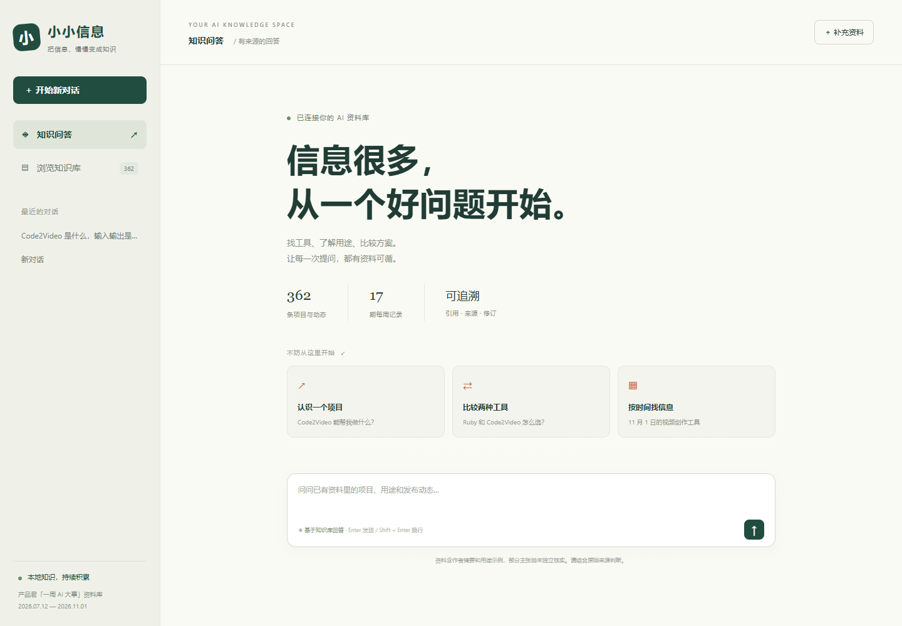

# 小小信息

一个可以提问、查看来源、逐步补充资料的 AI 知识库。初始内容来自已整理的产品君「一周 AI 大事」：**2026 年 7 月 12 日至 11 月 1 日，17 期、362 条记录**。

**2026-11-03 更新：**另行收录 20 个 GitHub AI 项目，当前随仓库提供 **382 条资料**。本批均超过 2 万星，核对了维护记录、固定版本官方说明和许可证，未安装实测。每个项目包含详细用途、场景、入门方式和限制。查看 [项目精选与来源](docs/GitHub项目精选_2026-11-03.md) 或 [可导入的 JSON](data/collections/github-2026-11-03.json)。



## 在本机运行

需要 Python 3.11 或更新版本。Windows PowerShell 中执行：

```powershell
git clone https://github.com/Kais12349/xiaoxiaoxinxi.git
cd xiaoxiaoxinxi
python -m venv .venv
.\.venv\Scripts\python.exe -m pip install -r requirements.txt
Copy-Item .env.example .env.local
```

用文本编辑器打开 `.env.local`，填写自己的 DeepSeek API key：

```dotenv
DEEPSEEK_API_KEY=填写自己的密钥
DEEPSEEK_BASE_URL=https://api.deepseek.com
DEEPSEEK_MODEL=deepseek-flash
HOST=127.0.0.1
PORT=8765
APP_ACCESS_TOKEN=
```

启动：

```powershell
.\.venv\Scripts\python.exe main.py
```

打开 **http://127.0.0.1:8765**。以后也可以双击 `启动.bat`。macOS / Linux 使用 `.venv/bin/python`，配置文件可用 `cp .env.example .env.local` 复制。

密钥只在后端读取，不会发送给网页。`.env.local`、数据库、对话和本地备份都已加入 Git 忽略规则。没有密钥时，可以浏览、编辑和导入资料，问答会明确提示缺少配置。

## 可以做什么

- **连续提问**：例如“Code2Video 是什么，适合什么场景？”，再追问“和 Ruby 的用途有什么区别？”。模型先调用检索工具，再根据资料回答。
- **查看证据**：回答中的项目名称引用和来源卡片可打开条目，查看详细用途、作者摘要、核对说明、原始链接及修订记录。来源多时先显示四条，可展开全部；来源只展示本轮答案实际引用的资料。
- **浏览知识库**：按项目名称、用途、类别和日期筛选。中文用字词索引、英文用关键词检索，并扩展常见用途同义词；已知项目名会限定到相应项目，多项目比较保留双方，寻找替代方案可明确写“类似”或“替代”。不需要额外的向量或嵌入服务。
- **逐步完善**：点击“补充资料”新增条目，或打开已有条目编辑。保存后更新检索索引，下一轮问答就能读取新版本；旧版本保留在修订记录中。修改时会检查版本，防止覆盖他人的新修改。
- **导入和备份**：JSON / CSV 支持批量导入，Markdown / TXT 按一篇文档导入。文件最多 2 MB、每批最多 1000 条；文档或单个说明字段最多 30000 字。导入前会校验整个批次，同一天同名条目跳过，不覆盖已有修订。原始 `信息清单.csv` 可以直接导入。
- **保留对话**：问答和来源保存在本机，重新打开仍可继续。等待时显示阶段和用时，可停止生成，也可以先写下一条问题。失败后可重试或放回输入框修改，已有草稿不会被覆盖；未完成问答不写入历史。

目前 Agent 有 `search_knowledge`、`get_entry`、`knowledge_stats` 三个读取工具，最多运行 5 轮。网页先显示检索进度，回答边生成边显示，完成后可点击引用查看来源。它不自动上网、不自动修改知识库；新资料需要明确导入或编辑。这能让资料逐步积累，同时保留来源和修改依据。

## 导入格式

JSON 文件可使用以下结构。`name` 和 `function` 必填；`date` 建议明确提供，缺省为服务器当天日期。导出的 JSON 可直接重新导入。

```json
[
  {
    "name": "示例项目",
    "date": "2026-11-03",
    "organization": "项目团队",
    "category": "视频",
    "function": "具体解决什么问题，接收什么输入，产生什么输出。",
    "scenario": "适合哪些人、哪些实际工作。",
    "workflow": "如何开始使用，需要哪些输入或前置条件。",
    "limitations": "已知限制、需要人工检查的部分。",
    "links": ["https://example.com/project"],
    "verification": "来源及核对范围，例如：已阅读官方文档，尚未实测。",
    "notes": "其他需要保留的信息。"
  }
]
```

CSV 可使用上述英文字段名，也兼容原始信息清单中的中文列名。多个链接可用空格或换行分隔。

## 数据来源和边界

初始结构化资料位于 `data/knowledge.json`，与仓库中的原始整理文件对应：

- `产品君_AI周报时间线.html`：含各期总结图片的原始时间线。
- `产品君_AI周报_2026-07-12至11-01.md`：逐项详细说明和来源。
- `信息清单.csv`：可用表格软件筛选的清单。

这份资料来自作者同步视频及总结索引的整理，**并不表示已逐条观看抖音原视频、实测所有产品或核实全部发布主张**。`reported_claim` 保留作者当期摘要；`function`、`scenario`、`workflow` 含用途解释和应用示例；`verification` 记录核对范围。部分名称、时间和链接可能仍有不匹配，需要结合原始来源修订。助手会区分这些信息，不将历史周报自动视为当前产品状态。

后续 GitHub 精选单独保存在 `data/collections/`，不属于作者周报。条目日期为收录及核对日期，并非项目发布日；精确星数、提交、来源链接与筛选条件保存在对应的 [元数据快照](data/github-2026-11-03.metadata.json)。星数和最近提交仅是筛选指标，实际使用仍需验证效果、资源需求与许可条件。

检索使用关键词与同义词，可能漏掉表达差异较大的资料；可换名称或用途关键词重试。模型回答也可能出错，引用用于核对，不能替代原始来源。

## 数据保存和迁移

首次启动时，种子资料只导入一次。之后新增资料、修订和对话保存在 `runtime/knowledge.sqlite3`，重启不会覆盖它们。

更新代码并重启后，`data/collections/` 中的新 JSON 批次会自动导入现有数据库；新安装也会载入这些批次。每个文件名作为不可变的批次标识，只导入一次，同一天同名条目跳过。已导入资料及用户修改不会被重新覆盖。检索索引有单独的版本号，算法升级时自动重建派生索引，保留条目、修订和对话。后续补充请使用新批次文件；修正已有条目可在网页编辑，或另行实施带版本检查的迁移。原始三份周报整理文件不随精选批次改写。

网页的“导出备份”导出**当前全部知识条目**，不含对话和历史版本。需要完整迁移时，先停止服务，再复制整个 `runtime/` 文件夹；恢复到相同路径后启动。更新 GitHub 上的代码不会上传本地数据库。多台机器各有独立数据，需要自行迁移或部署一个共享服务。

## 部署说明

这是 Python 后端应用，GitHub 仓库用于保存代码；GitHub Pages 不能运行问答后端。默认只监听本机。部署到服务器时应使用 HTTPS，并设置 `APP_ACCESS_TOKEN`；设置 `HOST=0.0.0.0` 后，程序会要求先配置访问口令。网页会提示输入该口令。

可使用附带的 Dockerfile：

```sh
docker build -t xiaoxiaoxinxi .
docker run --rm -p 8765:8765 --env-file .env.local -e HOST=0.0.0.0 -v xiaoxiao-data:/app/runtime xiaoxiaoxinxi
```

运行前在配置中设置强访问口令。`runtime/` 必须使用持久卷，否则容器重建会丢失新增资料。此版本是个人 / 受信任团队共享空间，同一访问口令下可查看全部对话和编辑全部资料；尚无独立用户账号和权限分级。

## 验证

```powershell
python -m unittest discover -s tests -v
node --check web/app.js
```

自动检查覆盖历史资料与精选批次数量、现有数据库升级、索引迁移、重复启动与修订保留、批次原子性、双语检索、项目追问与比较、日期过滤、CSV 兼容、会话隔离、缺少密钥、来源编号和接口访问控制。独立运行的 `tests/live_check.py` 会向已启动的本机服务发送真实问答，用于验证 DeepSeek 工具调用、追问、无资料回答及空来源、对话持久化；这会产生 API 用量，并留下测试对话。参见 [对话与体验验证记录](docs/对话与体验验证_2026-11-03.md)。

## 文件布局

```text
main.py                 网页和 API 服务
agent.py                DeepSeek 工具调用与引用处理
knowledge.py            SQLite、检索、导入和修订
data/knowledge.json     362 条初始结构化资料
data/collections/       后续精选批次（启动时自动导入一次）
data/*.metadata.json    官方来源、指标与筛选快照
docs/                   项目精选说明与首页预览
web/                    网页
tests/                  自动检查与可选真实模型验证
runtime/                本地数据库（不提交）
.env.local              本地密钥和配置（不提交）
```
